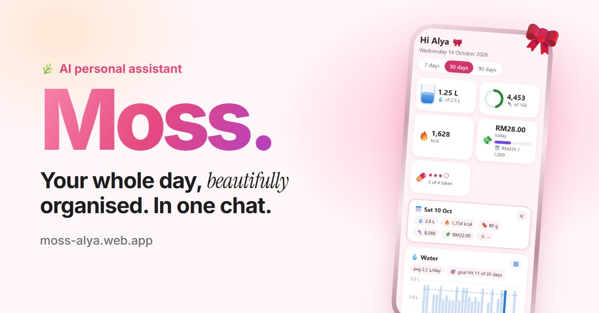
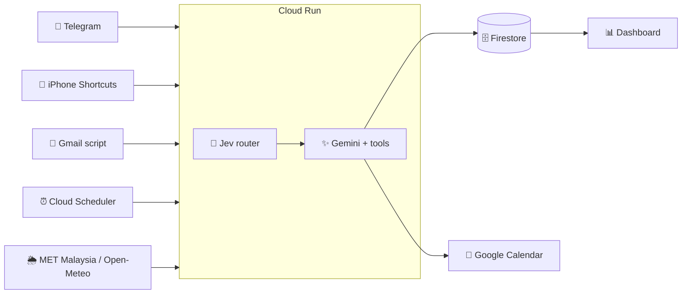

# Moss 🌿

**A personal AI assistant that lives in Telegram.** Text it, talk to it or send a photo, and it tracks
food, money and habits, manages tasks and the calendar, sends live storm and haze alerts, and writes
weekly and monthly reports.

[](https://moss-alya.web.app)

**👉 Interactive demo: [moss-alya.web.app](https://moss-alya.web.app)**

## Highlights
- **Gemini tool-calling** with 31 Python tools (logging, tasks, bills, calendar, weather...)
- **Jev (TypeSafe) router** picks the tools for each message first: **36% fewer** Gemini prompt tokens
- **Google Cloud Run + Firestore**, Cloud Scheduler for reminders, Secret Manager for keys
- **113 automated tests** (pytest, with an in-memory fake Firestore) on every push via GitHub Actions
- **iPhone:** Siri commands, Control Centre "Spend", Apple Pay and Apple Health, all through Shortcuts
- **Live data:** MET Malaysia storm warnings (data.gov.my), Open-Meteo rain and air quality, Gmail receipts
- **Web dashboard** (Chart.js) behind one-time login links and signed cookies

## How it works



| | |
|---|---|
| `MosshyBot.py` | Telegram, Gemini, panels and buttons |
| `jev_router.py` | Picks the tools for each message |
| `tracker.py` | Logging, goals, budgets, tasks (Firestore) |
| `reminders.py` | The 15-minute tick: briefing, nudges, alerts |
| `weather.py` | Rain forecast, storm warnings, air quality |
| `cloud_server.py` | Webhook, jobs, Siri endpoint, dashboard |

Everything below is the full guide to running your own copy.

---


## Setup (about 10 minutes, one time)

### 1. Create your Telegram bot
1. On your iPhone, open Telegram and search for **@BotFather** (blue tick).
2. Send `/newbot`.
3. Give it a display name, e.g. `My Assistant`.
4. Give it a username ending in `bot`, e.g. `my_helper_bot`.
5. BotFather replies with a **token** like `1234567890:AAF...`. Keep it secret.

### 2. Fill in your secrets
1. Open the file `.env` in this folder (VS Code shows it in the sidebar).
2. Paste your Telegram token after `TELEGRAM_BOT_TOKEN=`
3. Paste your Gemini key (from https://aistudio.google.com → *Get API key*) after `GEMINI_API_KEY=`
4. Save the file.

### 3. Run the bot
In the VS Code terminal:

```
.venv\Scripts\python MosshyBot.py
```

You should see `Bot is running...`. Leave this window open: the bot only works while it runs.

### 4. Lock it to you
1. In Telegram, open your bot and send `/start`.
2. It replies with your **user ID**. Put that number after `ALLOWED_USER_ID=` in `.env`.
3. Stop the bot (Ctrl + C) and run it again.


Done! Send `/help` to see everything it can do.

## What it can do
Moss is a sweet, coquette-style assistant 🎀 (personality in `SYSTEM_INSTRUCTION`
in `MosshyBot.py`). Just talk to it like a friend. It works out what to save:

| You send | It does |
|----------|---------|
| "had nasi lemak and teh tarik" | Logs food + drink with estimated calories |
| 📸 photo of your lunch | Recognises the food, estimates calories, logs it |
| 📸 photo of a receipt | Logs the expense |
| "Spotify RM16.90 every 15th", "TNB around RM80 due on the 20th" | Subscriptions log themselves on renewal day (with a heads-up 3 days before); bills remind you before, on and after the due day with a ✅ Paid button. See them all with `/bills` |
| "my food budget is RM200 a month" | Monthly budget: shows what's left after each expense, warns gently at 80% and 100% |
| "fixed the RAG bug, met the team about the dashboard" | Saves work notes, which become your log book / report drafts |
| 🎙️ voice note (English, Malay or both) | Writes down what you said (shown at the top of the reply), then handles it like a typed message |
| "drank 500ml water", "took vitamin D" | Logs water / supplements |
| "gym: squat 3x8 50kg", "brisk walk 3.2km 40 min" | Logs the workout: km, minutes, kcal burned (kept separate from kcal eaten) |
| "pay TNB bill by Friday", "skincare every day" | Adds to your to-do list (one-off or 🔁 daily) |
| "done with the assignment!" | Ticks the task off |
| reply "no walnuts, I ate half" to a food log | Corrects that entry |
| "period started today", "cramps today" | Logs your cycle |
| "finished week 3 of Python course" | Logs study progress |
| "presented Q3 report to my manager" | Logs a work win (becomes resume bullets later) |
| "my water goal is 2.5L a day" | Saves a goal to compare against |
| "how much did I spend this week?" | Looks it up |
| "Python class Thursday 2-4pm" | Adds it to Google Calendar (after setup below) |
| "Aisyah's birthday is 2 Nov, every year" | Yearly all-day event, reminder the day before |
| "class every Thursday 2-4pm until 18 Dec" | Weekly repeating event |
| "what's on tomorrow?", "move my dentist to Friday 3pm" | Reads / changes your calendar |
| "add vitamin D, fish oil and creatine 5g to my quick buttons" | One-tap buttons (see 💊 Supplements below) |
| "cancel my dentist" | Shows ✅ Yes / ❌ No buttons. Only deletes when you tap Yes |
| "undo that" | Deletes the last entry |

Commands: `/today`, `/supps`, `/water`, `/period`, `/tasks`, `/report` (`/report week`),
`/export`, `/news`, `/reminders`, `/reset`, `/help`.

`/reset` clears Moss's chat memory **and** deletes the chat's messages, as far back as Telegram
allows (48 hours). For older ones, use Telegram's own **Clear History**. Your logs stay saved.

**Reports** (`reports.py`): food and drinks are logged with estimated kcal plus sugar,
protein, carbs and fat grams. The weekly report compares with your last 3 weeks; the
monthly report (1st of the month, 9am) compares with your last 5 months and your
weight history, and ends with watch-outs and 3 focus goals.

**💊 Supps / 💧 Water / 🩸 Period / 📝 Tasks / 🌸 Today**: buttons under the typing
box (send `/start` once to make them appear).
- 🩸 Period: cycle day, phase, next period, fertile window (estimates, not birth
  control), plus one-tap Started / Ended / symptom buttons. Logic in `period.py`.
- 📝 Tasks: today's to-dos as tick boxes. 🔁 repeating tasks come back on their days
  (every day, or set weekdays like "log book every weekday 4pm", "weekly report Tue & Fri"),
  one-off tasks stay until ticked, overdue ones are marked. A ticked 🔁 task leaves the
  list until its next day ("🔁 2 habits done"); a ticked one-off task stays for the day,
  so you can see what you did. Night habits (reminder at 8pm or later) only show from
  8pm. Habits on set days with a time are reminded **an hour early** ("In 1 hour (4pm)").

**Work write-ups**: tasks can carry a draft ("daily_log" or "work_report"). Their
reminder then comes with a ready-made draft in plain professional English, written
only from your work notes (and calendar), in a box you tap to copy. With no notes yet,
it asks what you worked on. Send Moss an example of your log book to change the format.

**Tidy chat**: there's only ever one of each panel. Opening a new one deletes the old
one (and your button tap). Tapping ✅ Done on a reminder deletes the reminder and
updates the 📝 Tasks panel in place; an unanswered reminder is replaced by the next
one; event and weigh-in reminders have a 👌 Got it button that removes them.
(Telegram lets bots delete messages for up to 48 hours.)
- 💊 Supplements: a daily checklist. Tap to tick ✅, tap again to untick, or
  "Took all the rest". Change the list by chatting ("add magnesium to my quick buttons").
- 💧 Water: +250 / +500 / +1000 ml, a progress bar towards your goal, and ↩️ Undo last.

Taps don't use Gemini, so they're instant and free.

**Automatic reminders** (`reminders.py`, checked every 15 minutes; switch each on/off with `/reminders`):
| When | What |
|------|------|
| 1st of the month, 7:30am | ⚖️ Gentle weigh-in reminder (just reply "55.2 kg") |
| 8:00am | 🌅 Morning briefing: rain forecast ☔, today's events, tasks, supplements, yesterday's recap |
| 12pm-midnight | ⛈️ Heavy rain alert when MET Malaysia issues a thunderstorm or rain warning for your areas (checked every 15 min; "I work in Cyberjaya" sets them) |
| any time, 6am-11pm | 😷 Air quality / haze alert when the AQI gets worse (101+ = unhealthy for sensitive groups), and when it clears up. The briefing shows today's AQI too |
| Sunday 7:30pm | 📊 Weekly report: numbers, wins, watch-outs (e.g. food spending, sugar), 3 suggestions, vs your last 3 weeks |
| 9:00am (only when relevant) | 🩸 Period heads-up 2 days before, a check-in if late, "has it ended?" |
| 11am, 2pm, 5pm, 8pm | 💧 Water nudge, only if you're behind pace for your goal |
| ~30 min before an event | 📅 "Starting soon" for anything in your Google Calendar |
| 8:30pm | 📅 Tomorrow's events (incl. birthdays / all-day) |
| 9:00pm | 🌙 Check-in with leftover supplements and tasks |
| any time you ask | ⏰ "remind me to call mum at 3pm", "skincare every day at 10pm" |

**`/export`** sends you an Excel file. Tap it in Telegram to open it on your iPhone:
- **Habits**: one row per day (calories, water, workouts, supplements, study, sleep,
  spending). Green cells = goal met, red = over your calorie goal, plus 3 charts
- **Spending**: every expense, totals by type (food, transport, bills...), pie chart
- **All entries**: everything, with filter buttons on each column

`/export` = this month · `/export 2026-09` = a past month · `/export all` = everything

**Automatic messages** (only while the bot is running on your PC):
- 1st of each month, 9:00am: your personal growth report for the month that just ended
- Every Monday, 8:30am: AI & tech news + Malaysian tech events

## Turning on web search (for /news)
`/news` uses Gemini's Google Search add-on. A free API key may have no search quota,
so you'll see a "quota is used up" message. To fix it:
1. Claim your Google AI Pro cloud credits (Google Developer Program → Benefits).
2. In https://aistudio.google.com → **Get API key**, set up billing for your key's project.
3. Set a budget alert in Google Cloud Billing (e.g. RM20) so there are no surprises.

## Connecting Google Calendar (one time, ~15 minutes)
Do this on your PC, logged in to the same Google account as your calendar.

**A. Turn on the Calendar API**
1. Go to https://console.cloud.google.com
2. At the top, pick the **same project** your Gemini API key uses.
3. Search bar → **Google Calendar API** → **Enable**.

**B. Tell Google about your app** (it's just for you, nobody else will see it)
1. Search bar → **Google Auth Platform** (also called *OAuth consent screen*) → **Get started**.
2. App name: `MosshyBot`. Support email: yours. Audience: **External**. Contact email: yours. Agree → **Create**.
3. Go to **Audience** → **Test users** → **+ Add users** → enter your own Gmail → **Save**.
   (The app stays in "Testing" mode, so Google logs the bot out of your calendar
   every 7 days. The bot will tell you; just run step D1 again. To stop this, the app
   needs a homepage + privacy policy page so it can be published. Planned for Phase 5.)

**C. Download the app's ID file**
1. Go to **Clients** → **Create client** → Application type: **Desktop app** → name `MosshyBot PC` → **Create**.
2. Click **Download JSON**.
3. Rename the downloaded file to `credentials.json` and move it into this project folder.

**D. Log in**
1. In the VS Code terminal: ``.venv\Scripts\python connect_google.py
2. A browser opens → choose your account.
3. Google warns **"Google hasn't verified this app"**. That's expected: it's *your own*
   app, not a public one. Click **Advanced** → **Go to MosshyBot (unsafe)** → tick the
   calendar permission → **Continue**.
4. The terminal prints your next 7 days of events. Restart the bot. Done!

The bot can only manage **events** (not delete calendars or share them).
`credentials.json` and `token.json` stay on your PC. Never share them.

## Running in the cloud (24/7)
The bot runs on **Google Cloud Run** in Singapore, so it works even when your PC is off.

```
Telegram ──webhook──▶ Cloud Run "mosshybot" (cloud_server.py)
                          ├─▶ Gemini (the brain)
                          ├─▶ Firestore (your data, chat memory, Calendar login)
                          └─▶ Google Calendar
Cloud Scheduler ──▶ /jobs/monthly-report (1st, 9am) and /jobs/weekly-news (Mon, 8:30am)
```

- Keys live in **Secret Manager** (`telegram-bot-token`, `gemini-api-key`,
  `telegram-webhook-secret`, `job-secret`), not in files.
- The bot runs as its own account, `mosshybot-run`, which can only use Firestore and those secrets.
- It sleeps when idle (free); the first message after a quiet spell takes a few seconds longer.
- Logs: console.cloud.google.com → Cloud Run → mosshybot → **Logs**.

**Deploying is automatic.** Every push to GitHub runs the tests, and if they all
pass, deploys the new version (~5 minutes). See it at github.com/YOUR-USERNAME/YOUR-REPO →
**Actions** (`.github/workflows/deploy.yml`). GitHub logs in to Google Cloud with no
key file ("Workload Identity Federation", trusted only for this repo) as
`mosshybot-deployer`, which can only deploy. To deploy by hand instead:
```
gcloud run deploy mosshybot --source . --region asia-southeast1
```

**Tests**: `.venv\Scripts\python -m pytest` runs 44 tests in ~2 seconds, against an
in-memory pretend Firestore (`tests/fake_firestore.py`), so no keys or internet needed.

**Run on your PC instead** (e.g. to test changes): `MosshyBot.py` refuses to start
while the cloud bot is active, so it can't take your messages by accident. To really
run it here, use `.venv\Scripts\python MosshyBot.py --take-over`. Afterwards, give
the messages back to the cloud bot:
```
.venv\Scripts\python telegram_webhook.py set https://YOUR-SERVICE-URL.a.run.app
```
`telegram_webhook.py info` shows where messages are going right now.

**Changing a key** (e.g. a new Gemini key): Secret Manager → the secret → **New version**,
then redeploy.

## Web dashboard
Charts of your habits, money and health, at your bot's address + `/dashboard`
(`dashboard.py`, served by the cloud bot, so your data never leaves your Google Cloud).
Send **/dashboard** to Moss: the button inside is a one-time login link (works once,
for 15 minutes) that keeps that browser logged in for 30 days. Tip: open it in Safari,
then Share → **Add to Home Screen** for an app-like icon.

**Project page:** https://moss-alya.web.app (`site/`, the public showcase and privacy policy). After changing it, run `.venv\Scripts\python publish_site.py` (set GOOGLE_CLOUD_PROJECT and FIREBASE_SITE first).

**The dashboard's address is https://moss-alya.web.app/dashboard.** That's Firebase Hosting, which passes
`/dashboard` on to Cloud Run (free, and nicer than the `...run.app` address). The
`DASHBOARD_URL` setting on Cloud Run makes the /dashboard button use it. The login
cookie is called `__session` because that's the only cookie Firebase passes on.

Made to read at a glance: today's water as a filling 💧 glass, steps as a 👟 ring,
calorie and money meters, supplement dots; then 7/30/90-day charts with one colour
and emoji each (💧 water, 🔥 calories, 🍬 sugar, 👟 steps, 💸 spending, 🏃‍♀️ workouts)
and a one-line summary. **Tap any bar** to see that whole day at the top (it's
highlighted on every chart); 🔢 shows the exact numbers. Plus budgets, spending by
type, bills & subscriptions, cycle and weight.

## Siri commands & Apple Health (iPhone)
Your iPhone's **Shortcuts** app can talk to the cloud bot directly (`siri.py`):
"Hey Siri, **log water**", "Hey Siri, **took my supplements**", "Hey Siri, **ask Moss**"
(Siri reads the answer aloud), a **Spend** button in Control Centre, plus a nightly **Apple Health** sync of steps and walking
distance. Each request carries a secret code, so only your Shortcuts can use it.

**First: get your address and secret.** Send **/siri** to Moss in Telegram. Tap each
grey value to copy it. (Delete that message when you're done.)

**Shortcut 1: "Log water"** (Shortcuts app → **+** at the top right)
1. **Search Actions** → type `Get Contents of URL` → tap it.
2. Tap the blue **URL** → paste the **Address**.
3. Tap the **›** arrow under it to show more options:
   - **Method** → `POST`
   - **Headers** → **Add new header** → Key `X-Shortcut-Secret`, Text: paste the **Secret**
   - **Request Body** → `JSON` → **Add new field** → **Text** → Key `action`, Text `water`
4. **Search Actions** → `Speak Text` → tap it (it speaks "Contents of URL").
5. Tap the name at the top → **Rename** → `Log water` → **Done**.

Now say **"Hey Siri, log water"**. Siri's phrase is the Shortcut's name.

**Shortcut 2: "Took my supplements"**: in the Shortcuts list, long-press **Log water** →
**Duplicate**. Open the copy, change the `action` value to `supplements`, and rename it
`Took my supplements`.

**Shortcut 3: "Ask Moss"**
1. New shortcut → add **Dictate Text** (it listens to you).
2. Add **Get Contents of URL**, set up as in Shortcut 1, but with **two** JSON fields:
   `action` = `ask`, and `text` = tap the value field → **Select Variable** → **Dictated Text**.
3. Add **Speak Text** → rename the shortcut `Ask Moss`.

Say "Hey Siri, ask Moss", wait for the beep, then e.g. "how much water today?" or
"had roti canai and kopi o".

**Shortcut 4: "Spend"** (type a price from Control Centre, no talking)
1. New shortcut → add **Ask for Input** → Input Type **Number**, Prompt `How much? (RM)`.
2. Add another **Ask for Input** → Input Type **Text**, Prompt `What is it?`.
3. Add **Get Contents of URL**, set up as in Shortcut 1, with **three** JSON fields:
   `action` = `spend`, `amount` = **Select Variable** → the first **Provided Input**,
   `item` = the second **Provided Input**.
4. Add **Show Notification** (it shows "Contents of URL") → rename the shortcut `Spend`.
5. Add it to Control Centre: swipe down from the top-right corner → **+** at the top
   left → **Add a Control** → search `Shortcut` → tap it → choose **Spend**.

Moss sorts it into food, transport, shopping, health, fun, education, bills or other
by itself (one tiny Gemini call) and tells you what's left in your budgets.

**Apple Pay automation** (logs every tap of your phone by itself)
1. Shortcuts → **Automation** → **+** → **Transaction** → pick your card(s), leave
   Merchants and Categories as they are → **Run Immediately** → **Next** →
   **New Blank Automation**.
2. Add **Get Contents of URL**, set up as in Shortcut 1, with JSON fields: `action` =
   `spend`, `amount` = **Shortcut Input** (tap it → choose **Amount**), `item` =
   **Shortcut Input** → **Merchant**, `notes` = `Apple Pay`.
3. Add **Show Notification** with **Contents of URL**.

Don't use the Spend button for the same purchase, or it's saved twice.

**Gmail receipts** (purchase emails logged by themselves, `receipts.py`)
A small script in your own Gmail checks for new receipt emails every hour (Shopee, Grab,
foodpanda, bank transfers...) and sends each one to Moss. Moss saves what you paid for and
tells you in Telegram. It skips promos, transfers to your own accounts, e-wallet top-ups
(Touch 'n Go, ShopeePay...), subscriptions already in your bills, and anything with the
same price you already logged that day. Each email gets the **Moss** label once it's done.
1. On a computer, open **script.google.com** (signed in to your Gmail) → **New project**.
2. Delete what's there and paste everything from `gmail_receipts.gs`. Paste your
   **Address** and **Secret** from /siri between the quotes at the top. Save (💾).
3. In the function menu at the top, pick **setup** → **Run**. Google asks for permission:
   **Review permissions** → your account → **Advanced** → **Go to (project) (unsafe)** → **Allow**.
   (It's "unsafe" only because it's your own script that Google hasn't reviewed.)
4. Done: it checked just now and runs every hour. **Executions** (left menu) shows what it sent.

**Moss on your Home Screen**: new shortcut → **Open URLs** → `tg://resolve?domain=`
followed by the bot's username (without @) → rename it `Moss` → tap the **ⓘ** →
**Add to Home Screen** (you can pick a photo as the icon). It opens your chat straight away.
For one-tap buttons, add the **Shortcuts** widget to your Home Screen too.

**Apple Health nightly sync** (Shortcuts → **Automation** tab → **+**)
1. **Time of Day** → `11:30 PM`, **Daily** → choose **Run Immediately** (so it doesn't ask
   every night) → **Next** → **New Blank Automation**.
2. Add **Find Health Samples** → tap **Type** → `Steps`; filter **Start Date** `is today`.
3. Add **Calculate Statistics** → `Sum` of **Health Samples**.
4. Add **Find Health Samples** → Type `Walking + Running Distance`, **Start Date** `is today`.
5. Add **Calculate Statistics** → `Sum` of the second **Health Samples**.
6. Add **Get Contents of URL**, set up as in Shortcut 1, with JSON fields: `action` =
   `health`, `steps` = the first **Statistics**, `distance_km` = the second **Statistics**
   (tap each value → **Select Variable**).

Steps then appear in the weekly and monthly reports, the morning briefing, and the
Excel export. Syncing twice in a day just replaces that day's numbers, and a sync
just after midnight still counts for the day before.

## Jev: the message router (Phase 6)
[Jev](https://docs.typesafe.ai) is TypeSafe's "System One" model: it makes fast,
typed decisions with probabilities instead of writing text. Before Gemini sees a
message, Jev answers six yes/no questions about it in one ~0.3 s call (log it?
about past data? tasks? calendar? goals/buttons? just small talk?), and Gemini
only gets the tools for the jobs Jev said yes to (`jev_router.py`).

Measured on the same messages, all tools vs Jev-routed: **36% fewer Gemini prompt
tokens** (e.g. "thank you!" 5,446 → 2,041 tokens), with similar response times.

Safety net: if Jev is unsure, errors, is slow, or `TYPESAFE_API_KEY` is empty,
Gemini gets every tool, so Jev can only make things cheaper, never break them.
Your last reply is passed as context, so follow-ups like "ok" / "yes, all of them"
still get the tools they need. Jev's decisions show in the Cloud Run logs
("Jev 290 ms: {...} -> ['log']").

## Files
| File | What it is |
|------|------------|
| `jev_router.py` | Asks Jev which tools Gemini needs for each message |
| `dashboard.py` | The web dashboard: one-time login links, the charts page and its data |
| `bills.py` | Bills & subscriptions: due dates, paid status, reminders |
| `drafts.py` | Writes log book entries and supervisor reports from your work notes |
| `siri.py` | Siri commands and the Apple Health sync from your iPhone's Shortcuts |
| `weather.py` | Today's rain forecast for the briefing (Open-Meteo, free). Say "my area is Shah Alam" to set it |
| `receipts.py` | Gmail receipts: purchase emails become expenses (with `gmail_receipts.gs`) |
| `MosshyBot.py` | Talking to Telegram and Gemini, commands, scheduled messages |
| `cloud_server.py` | The web server Cloud Run runs (receives Telegram messages + scheduled jobs) |
| `chat_memory.py` | Saves the recent conversation in Firestore so it survives restarts |
| `telegram_webhook.py` | Points Telegram at the cloud bot (or shows where it points) |
| `Dockerfile`, `.dockerignore`, `.gcloudignore` | How the bot is packaged for the cloud, and what is never uploaded |
| `tracker.py` | Your data in Google Firestore + the "tools" Gemini can call to save and look things up |
| `reports.py` | Builds the monthly growth report |
| `exports.py` | Builds the Excel file for `/export` |
| `google_calendar.py` | The calendar "tools" Gemini can call |
| `connect_google.py` | Run once to log in to Google Calendar |
| `credentials.json` | Identifies your app to Google when logging in to Calendar. Never share |
| `token.json` | The old Calendar login file. The login now lives in Firestore, so this can be deleted |
| `migrate_to_firestore.py` | One-time copy of the old `mosshy.db` into Firestore (already done) |
| `mosshy.db` | The old database file, kept as a backup. Never share it |
| `.env` | Your secrets (never share this) |
| `.env.example` | A blank template of `.env` |
| `.venv/` | Python libraries the bot uses (don't edit) |
| `requirements.txt` | The list of libraries, used to rebuild `.venv` if it breaks |

If `.venv` ever breaks (e.g. after moving or renaming the folder), rebuild it:
```
Remove-Item -Recurse -Force .venv; python -m venv .venv; .venv\Scripts\python -m pip install -r requirements.txt
```

## Roadmap
- [x] Phase 1: chat, reply suggestions, task organiser
- [x] Phase 2: life tracker (food + photos, water, supplements, gym, period, work, study, money), goals, monthly growth report, AI news digest
- [x] Phase 3: Google Calendar (add/list/move/delete events by chatting) + Excel export
- [x] Phase 5a: code on GitHub, data in Firestore, running 24/7 on Cloud Run
- [x] Phase 4: morning briefing, reminders (water, events, tasks, evening check-in), period tracker with predictions
- [ ] Phase 5b: automated tests, auto-deploy from GitHub, published Google app (no weekly Calendar re-login)
- [x] Phase 6: Jev (TypeSafe) as the message router: 36% smaller Gemini prompts

## Skills this project shows (for your resume)
- Python bot on the Telegram Bot API (async, polling, scheduled jobs)
- LLM integration with Google Gemini: function calling (tool use), image understanding, web search grounding
- Database design: SQLite first, then migrated to Google Cloud Firestore (NoSQL) with a repeatable migration script
- Google Calendar API with OAuth 2.0 login
- Excel report generation with charts and conditional formatting (openpyxl)
- Serverless deployment on Google Cloud Run (Docker, Telegram webhooks, idempotent update handling)
- Cloud Scheduler jobs, Secret Manager, least-privilege service account, Firestore TTL policies
- Automated testing with pytest and an in-memory Firestore fake (44 tests)
- CI/CD with GitHub Actions: test, then deploy, using keyless Workload Identity Federation
- Web dashboard with passwordless one-time-link login (signed HttpOnly session cookie), Chart.js, mobile-first, cross-chart interaction
- iOS integration: Siri Shortcuts and Apple Health data sent to the cloud bot through an
  authenticated webhook, with idempotent daily upserts
- Model routing: a small "System One" decision model (TypeSafe Jev) picks tools per
  message for the LLM, measured at 36% fewer prompt tokens, with a safe fallback
- Secrets handling, access control, privacy-first data handling
